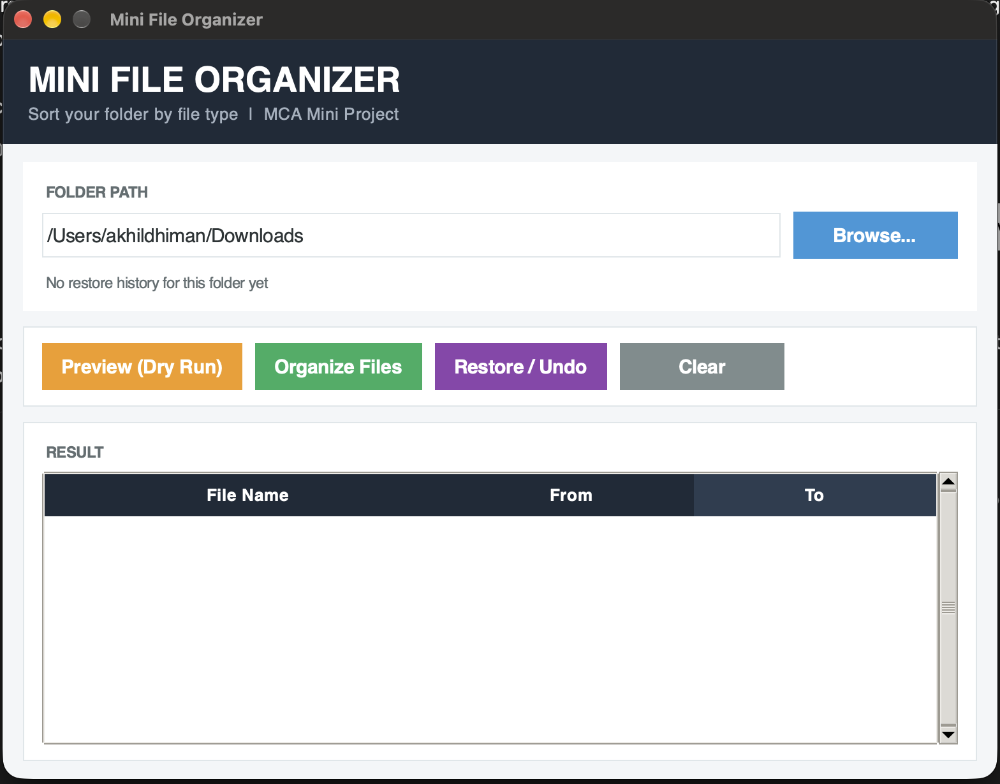
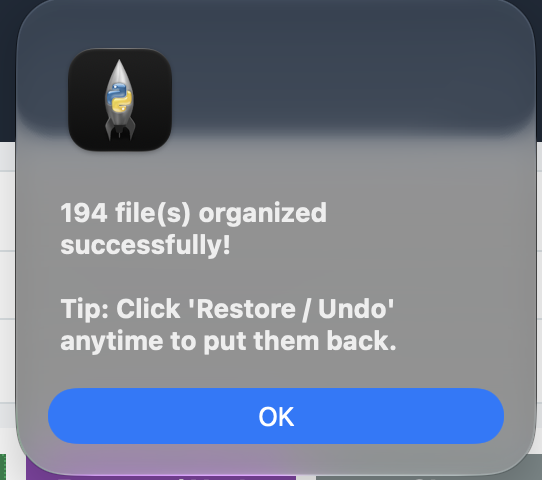

# INTELLIGENT FILE MANAGEMENT AND ORGANIZATION SYSTEM USING PYTHON

A simple desktop application that automatically cleans up any messy folder by sorting
its files into neat category folders — built completely with **Python** and **Tkinter**.
It also has a one-click **Restore / Undo** feature, so nothing is ever lost.



---

## 📌 About

Every user collects hundreds of files over time — PDFs, images, videos, documents and
installers all mixed together in one folder (most often the *Downloads* folder). Finding
a single file from such a folder takes a lot of time.

This project solves that problem. The user selects a folder, and the application reads
the extension of every file inside it and moves each file into the correct category
folder. A **Preview** option shows what will happen before anything is moved, and a
**Restore** button brings the folder back to its original condition at any time.

---

## ✨ Features

- 📂 **Browse dialog** — select any folder without typing the path
- 🏷️ **7 automatic categories** — Images, Documents, Music, Videos, Archives, Code, Others
- 👀 **Preview (Dry Run)** — see the planned changes without moving any file
- ↩️ **Restore / Undo** — puts every file back to its original location with one click
- 🛡️ **No overwrite** — duplicate file names are renamed (`_1`, `_2`, …) instead of replaced
- 📊 **Result table** — File Name, From and To columns with a live row count
- 📝 **Progress status bar** — shows `Moving… 3/5` and the final `Done!` message
- 💾 **History file** — the undo information is saved inside the folder as a hidden
  `.organizer_history.json` file, so restore still works after the app is closed
- 🧹 **Auto cleanup** — empty category folders are removed after a restore
- 💻 **Cross-platform** — standard Python libraries only, works on Windows / macOS / Linux

---

## 📂 File Categories

| Category  | Extensions handled                                                            |
|-----------|-------------------------------------------------------------------------------|
| Images    | .jpg .jpeg .png .gif .bmp .svg                                                |
| Documents | .pdf .doc .docx .txt .ppt .pptx .xls .xlsx                                    |
| Music     | .mp3 .wav .aac .flac                                                          |
| Videos    | .mp4 .mkv .avi .mov                                                           |
| Archives  | .zip .rar .7z .tar .gz                                                        |
| Code      | .py .java .c .cpp .html .css .js                                              |
| Others    | everything else (unknown extensions are never ignored)                        |

---

## 🛠️ Technologies Used

| S. No. | Technology     | Purpose                                                        |
|--------|----------------|----------------------------------------------------------------|
| 1      | Python 3       | Programming language of the application                        |
| 2      | Tkinter (ttk)  | GUI window, buttons, dialog boxes and the result table         |
| 3      | pathlib        | Folder reading and file name / extension handling              |
| 4      | shutil         | Moving files into the category folders                         |
| 5      | json           | Saving & reading the history file used by Restore / Undo       |

---

## ▶️ How to Run

**1. GUI version (recommended):**

```bash
python file_organizer_gui.py
```

**2. Terminal / menu-driven version:**

```bash
python file_organizer.py
```

No extra installation is needed — only Python 3.

---

## 📖 How It Works

1. **Select folder** — the path is validated with `Path.is_dir()`.
2. **Read files** — `Path.iterdir()` lists every file (folders are skipped).
3. **Classify** — the file extension is looked up in the `CATEGORIES` dictionary.
4. **Move** — `shutil.move()` transfers the file to its category folder
   (duplicate names are made unique first with `unique_path()`).
5. **Record** — each move is appended to the hidden history JSON file.
6. **Display** — a row is added to the Result table and the status bar is updated.
7. **Restore** — the history file is read and every file is moved back to its
   original path; then the history is deleted and empty folders are removed.

---

## 🧪 Testing

The application was tested on a real **Downloads** folder containing **194 files**:

- **Preview** listed all 194 files with their destinations — nothing was moved.
- **Organize** moved all 194 files into 6 category folders
  (Documents 98, Images 49, Videos 16, Others 24, Code 4, Archives 1)
  and the Result table showed 194 rows.
- **Restore** brought all 194 files back to the original folder and removed the
  empty category folders automatically — no file was missing.
- A folder organized by an older copy (without a history file) was also restored
  successfully — **233 files** returned to their original place.



---

## 📁 Project Structure

```
mini-file-organizer/
├── file_organizer_gui.py   # Tkinter GUI version (main program)
├── file_organizer.py       # Menu-driven terminal version
├── screenshots/            # Screenshots used in the README
├── .gitignore
└── README.md
```

---

## 🎓 Academic Information

| Field            | Detail                                        |
|------------------|-----------------------------------------------|
| Project Title    | Intelligent File Management and Organization System Using Python |
| Student Name     | Akhil Dhiman                                  |
| Course           | Master of Computer Applications (MCA)         |
| University       | Chandigarh University                         |
| Academic Session | 2026–2027                                     |
| Language         | Python 3                                      |

---

## 📄 License

This project is released under the [MIT License](LICENSE).
